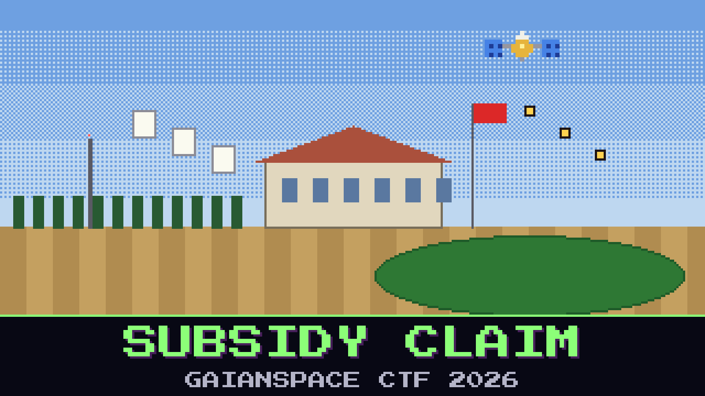

# 124-subsidy-claim

> 13:10, the county agricultural office, Békéscsaba. Babb's area claim for the north block has been rejected: *parcel already claimed, declared as pasture, satellite check passed.*

Someone filed a claim on Babb's corn, and the office's satellite check agreed with them. The clerk is helpful, up to a point. The office checks every declaration against the same Copernicus image with its own classifier and its own statistics file, and Babb may take copies of all of it. The clerk mentions, as if it were nothing, that the office left one class out of its statistics this year. Fieldwork is expensive, and nobody claims that crop around here anyway.

At 12:05 the co-op SDR caught the stranger transmitting one more time, on yet another channel. The stranger was talking to someone else now.

The north block is not the only parcel they lied about. Find every false declaration in the stranger's batch.

The flag is the stranger's claim codes for the false declarations, in the order the stranger sent them, joined with hyphens.

**Flag format:** `GAIANSPACE{XXXX-XXXX-...}`

## Files

- `coop_sdr_1205.sigmf-data` — the co-op SDR's bursts at noon
- `coop_sdr_1205.sigmf-meta` — the SDR's metadata for that file
- `office_check_20250704.tif` — the image the office checks against (five channels, georeferenced)
- `office_training.sta` — the office's class statistics
- `training_fields.geojson` — the office's training fields
- `parcels.geojson` — the parcel register for the area
- `rejection_letter.txt` — the office's letter to Babb

Contains modified Copernicus Sentinel data 2025.

## Hints

- **Greener is better** (cost 40): The office's classifier does more than name a class. It can also say how sure it is, and a parcel it is sure about tells you more than one it shrugs at.
- **The field nobody walked** (cost 60): A classifier that never met a class can't recognise it. The office kept the field. It only threw away what it learned there.
