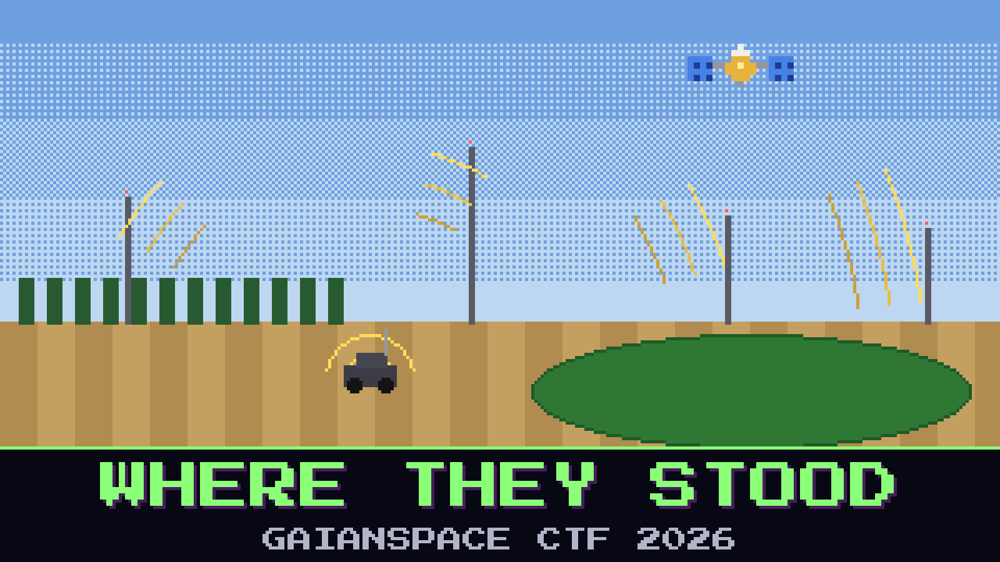

# 125-where-they-stood

> 13:40, the co-op yard, Mezőhegyes. The stranger's batch went out at 12:04 from somewhere on the plain. The co-op SDR heard every packet and has no idea where any of them came from.

The co-op runs four LoRa gateways for its soil probes: on Babb's grain dryer, on the co-op silo, on the town water tower and out at the pumps. Each one stamps what it hears with GPS time, down to the nanosecond, and all four were listening at noon. Laci, who looks after them, has already worked out a position from the survey sheet and drawn a circle round the big field west of the dryer. He is sure. The police are not driving out on a circle. They want a parcel number.

Find the parcel the stranger transmitted from.

**Flag format:** `GAIANSPACE{<parcel ID from the register>}` — for example `GAIANSPACE{MZH-0000}`.

## Files

- `gw_dryer_pktfwd.log` — the packet forwarder log from the gateway on Babb's grain dryer, 10:00–10:10 UTC
- `gw_silo_pktfwd.log` — the same from the co-op silo
- `gw_pivot7_pktfwd.log` — the same from the gateway out at the pumps
- `gw_tower_export.csv` — the water tower gateway's packet export for the same ten minutes
- `coop_gateways.csv` — the co-op's survey sheet for the four gateways
- `coop_worklog.txt` — Laci's work log for the gateways
- `parcels.geojson` — the parcel register for the area

Contains modified Copernicus Sentinel data 2025.

## Hints

- **Four clocks** (cost 40): Three gateways always agree on some point. The fourth one is the check, and the sheet is not the only record of where a gateway stands.
- **The long way round** (cost 60): The dryer stands behind a row of poplars. Not everything it heard came straight from the transmitter.
