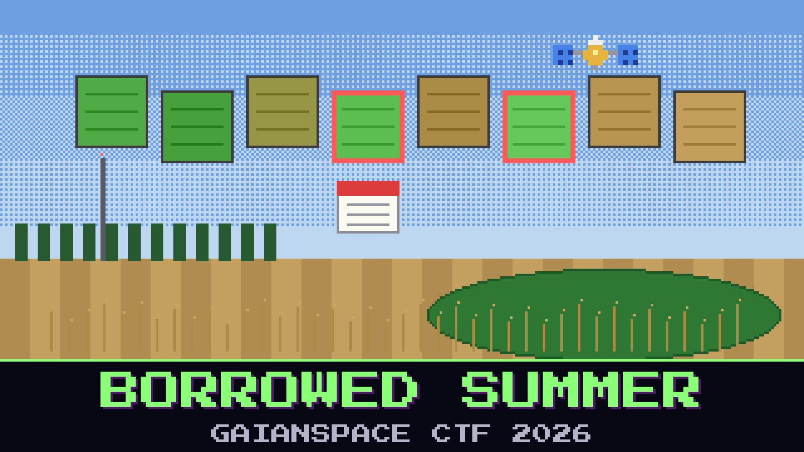

# 126-borrowed-summer

> 15:40, the Babb farm. The review request for the north block is in. Babb's phone rings: a Dr. Kuko Rica, from Hajdúnánás, who heard about the rejected claim from the county office.

Dr. Rica grows corn on the other side of the plain, and last year it happened to him first. In July and August 2024, the driest summer anyone there remembers, his AgriLink mast kept delivering tiles of fat green corn. His irrigation planner believed them and held back the water. By the time anyone walked the north block, most of it was gone. AgriLink looked into it and says every tile was genuine. Dr. Rica's young agronomist still says the July tiles were the best of the season.

Dr. Rica kept everything his mast received that year, and he has sent it all to Babb. If the stranger's hand is in his archive, the office will have to look at both farms again.

Some of the deliveries are not what they say they are. Find every one.

The flag is their delivery IDs from the mast journal, in the order the mast received them, joined with hyphens.

**Flag format:** `GAIANSPACE{XXXX-XXXX-...}`

## Files

- `rica_tiles_2024.zip` — every tile Dr. Rica's mast received in 2024 (AgriLink tile format: one manifest line, then five channels of 256 × 256 bytes)
- `rica_mast_journal.log` — the mast's delivery journal for the season
- `rica_parcels_2024.geojson` — Dr. Rica's parcels on the north block and the crops he declared for 2024, in tile pixel coordinates
- `agrilink_integrity_review.txt` — AgriLink's answer to Dr. Rica's complaint

Contains modified Copernicus Sentinel data 2023 and 2024.

## Hints

- **No way back** (cost 50): After midsummer a field on the plain only goes one way. It ripens, it dries, it gets cut. It doesn't turn back into a young green crop a fortnight later.
- **Genuine is not the same as true** (cost 70): AgriLink checked that every product is real. Nobody checked that the pixels came from that product.
