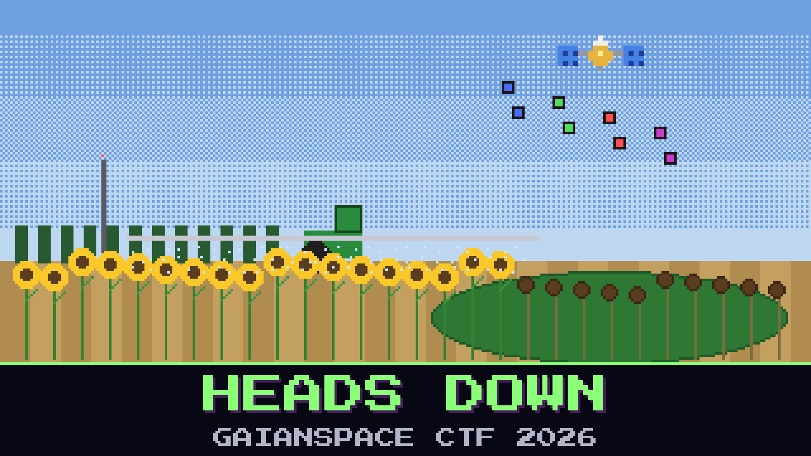

# 127-heads-down

> 14 August, 17:10. Szotyola Ltd., the north estate outside Orosháza. Dr. Rica's phone rings again, and this time Babb Ceresné comes along.

Szotyola grows sunflowers across half the Békés plain. Every August its contractor desiccates the fields that are ready, the way the AgriLink ripeness map says, and this morning's map came in at dawn. The sprayers were out by eight. By noon the estate manager was standing in a field that was still green, the heads still up, the desiccant already on the leaves. The contractor says it sprayed exactly what the map showed. AgriLink says it sent one clean pass, as always.

Szotyola had heard about the Babb farm. Since July the co-op's spare SDR has been sitting next to the estate mast, and its squelch recorder kept every burst of this morning's pass, each one levelled by its AGC. At 07:05 it was retuned to the dealer channel, because the contractor's sprayers take their jobs over the Johnripper radio, and it caught a full map of the estate's east block going out to them. Nobody at the estate sent it. Five fields on that map wear the same speckle. The sprayers will go to only one of them tonight.

Before the sprayers leave the yard at dusk, Dr. Rica wants two answers: which fields were sprayed while they were still green, and where the sprayers are going tonight.

**Flag format:** `GAIANSPACE{<green fields>_<tonight's field>}` — the parcel IDs of the fields sprayed while still green, in the order they appear in the register, joined with hyphens, then an underscore and the parcel ID of tonight's field. For example `GAIANSPACE{SZAAAA-SZCCCC_SZEEEE}`.

## Files

- `szot_sdr_0641.sigmf-data` — the co-op SDR's bursts from the morning pass, AgriLink channel (too large to attach: download it from [Hugging Face](https://huggingface.co/datasets/GaianSpace/ctf-2026-127/blob/main/szot_sdr_0641.sigmf-data))
- `szot_sdr_0641.sigmf-meta` — the SDR's metadata for that file
- `szot_sdr_0705.sigmf-data` — the same SDR on the dealer channel from 07:05 (download it from [Hugging Face](https://huggingface.co/datasets/GaianSpace/ctf-2026-127/blob/main/szot_sdr_0705.sigmf-data))
- `szot_sdr_0705.sigmf-meta` — the SDR's metadata for that file
- `band_order.conf` — the estate mast's band-order file, as it is now
- `mast_notes.txt` — the estate office's notes on the mast and the ripeness map
- `szotyola_parcels_2025.geojson` — Szotyola's parcel register for the estate, with the crops declared for 2025

Contains modified Copernicus Sentinel data 2025.

## Hints

- **Hint 1** (cost 60): Two transmitters, one channel, one setting, and the stranger has learned to tune. A whole chirp bin is far too coarse a ruler to tell them apart. Once you have two voices, ask which one you have heard before, and whose clock wanders.
- **Hint 2** (cost 80): Every speckled field is built from two kinds of pixel, in every channel you look at one by one. Ask whether that is still true when you look at all five channels together.
