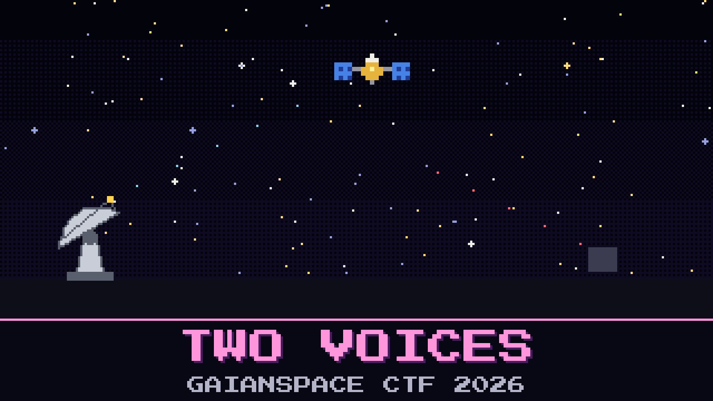

# 131-two-voices

> Night shift, GaianSpace MOC. GAIAN-723 dropped off the telemetry console at 01:12 and has not come back. The pass schedule says it is overhead right now.

David Aroz is alone on the SOC desk. Mission control has gone home, and the on-call engineer isn't answering. The ground station modem says nothing is there, but the station's raw recorder never stops, and Aroz pulled the last forty seconds of the band.

The waterfall is not empty. There are two voices in it. One of them is GAIAN-723. The other one is not on any GaianSpace frequency plan, and it is talking to our satellite.

The old frequency sheet pinned above the desk still says 433.000 MHz.

Find out what GAIAN-723 answered when the stranger first called it.

**Flag format:** `GAIANSPACE{...}`

## Files

- `vela_band_0114.sigmf-data` — the band recorder's raw capture (too large to attach: download it from [Hugging Face](https://huggingface.co/datasets/GaianSpace/ctf-2026-130/tree/main/131))
- `vela_band_0114.sigmf-meta` — the recorder's metadata for that capture
- `desk_notes.md` — Aroz's notes from the same watch; they can be wrong

## Hints

- **Not the same accent** (cost 30): The two voices do not sound alike. Whatever works for one will not work for the other.
- **The sheet is older than the night** (cost 50): Trust what the recording shows over what is pinned to the wall.
