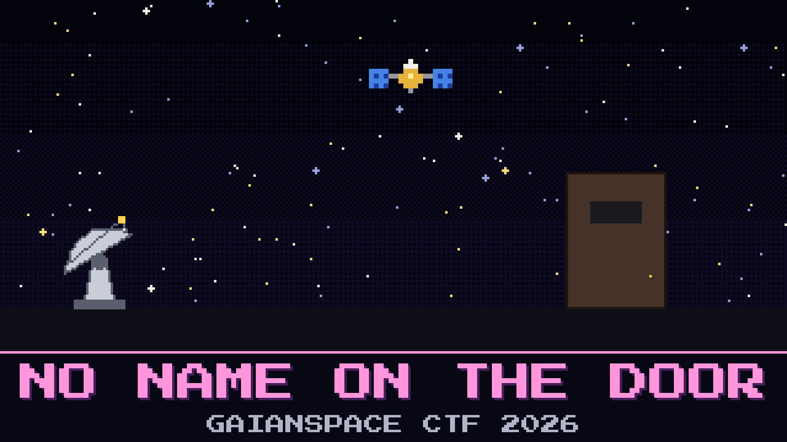

# 132-no-name-on-the-door

> 01:40. The stranger is still talking. Every few minutes GAIAN-723 answers, and every answer comes back in a voice the station modem refuses to hear.

Whoever has GAIAN-723 changed how it speaks. The packets no longer say how long they are, and each one sounds slightly different from the last. Aroz can see them on the waterfall but can't read them. The ground station log has a single line from 01:31: `DL CFG CHANGED BY TC — NOT FROM MOC`.

At 01:37 the stranger asked the satellite something, and the satellite answered. The thermal team will want to know what the cabin looked like at that moment.

Find the carbon dioxide reading GAIAN-723 reported when it acknowledged the stranger's command at 01:37, and how long the satellite said it had been awake.

**Flag format:** `GAIANSPACE{[CO2 in ppm]_[uptime in seconds]}`

## Files

- `vela_band_0136.sigmf-data` — the band recorder's raw capture (too large to attach: download it from [Hugging Face](https://huggingface.co/datasets/GaianSpace/ctf-2026-130/tree/main/132))
- `vela_band_0136.sigmf-meta` — the recorder's metadata for that capture
- `station_log.txt` — the ground station's event log for the same hour

## Hints

- **It still signs its work** (cost 30): GAIAN-723 never stopped checking its own sums. If a guess is right, the satellite will agree with you.
- **Count the breaths** (cost 50): A packet that won't say how long it is still takes exactly as long as it needs.
