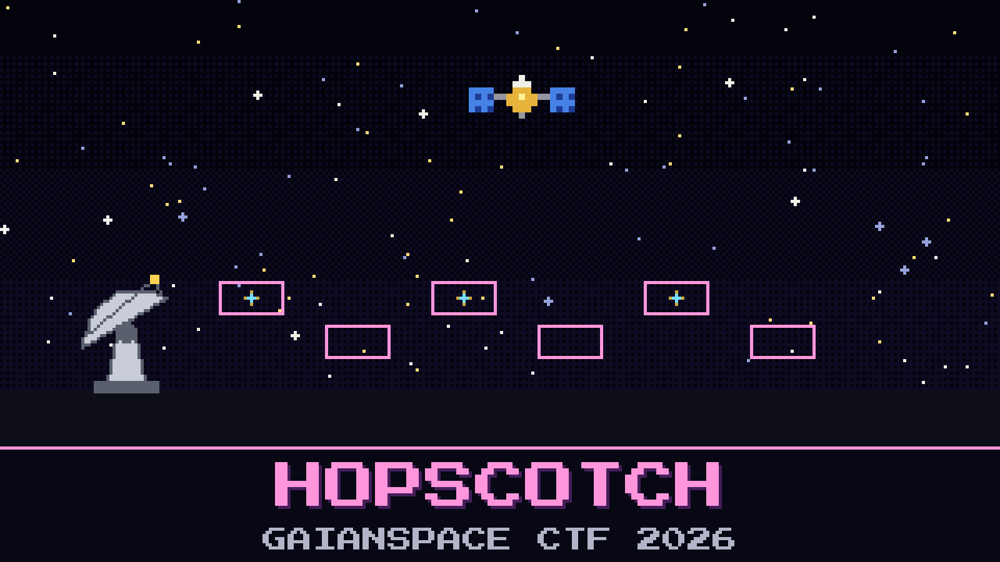

# 133-hopscotch

> 02:15. The downlink is gone from 433.175. Not quiet. Gone.

Aroz widened the recorder to the whole band. GAIAN-723 is still transmitting, but never in one place for long: short slivers jump across the band faster than the waterfall can draw them. A colleague's message from home just says *"if it jumps, it has a pattern. it was always built to jump."*

The stranger asked GAIAN-723 for something at 02:13, and the satellite answered in pieces scattered across the band.

Put the answer back together.

**Flag format:** `GAIANSPACE{...}`

## Files

- `vela_wide_0212.sigmf-data` — the band recorder's raw capture, opened up to the whole band (too large to attach: download it from [Hugging Face](https://huggingface.co/datasets/GaianSpace/ctf-2026-130/tree/main/133))
- `vela_wide_0212.sigmf-meta` — the recorder's metadata for that capture
- `chat.txt` — what came in on Aroz's phone while the recorder ran

## Hints

- **Same voice, many rooms** (cost 30): Wherever it lands, GAIAN-723 still sounds exactly like it did at 01:14.
- **Steps, not slides** (cost 50): It only ever jumps between words, never in the middle of one, and it never wanders far from where it was told to stand.
