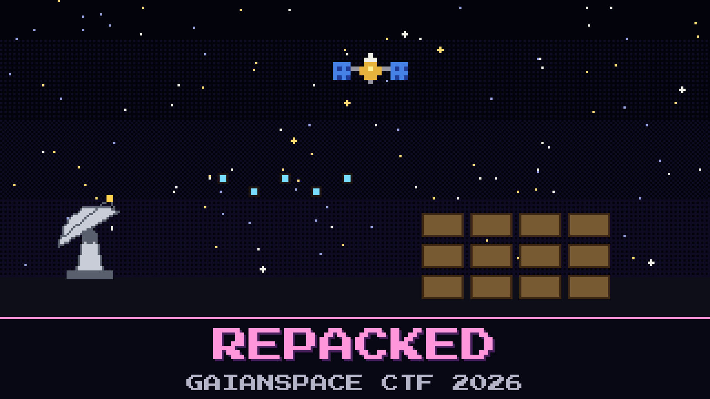

# 134-repacked

> 03:02. GAIAN-723 is back on one frequency, but its telemetry no longer looks like telemetry.

The stranger has repacked the downlink. There are no commas and no text, just short binary frames that never repeat. Aroz has the last good CSV line from before the incident, and the satellite is sitting on the same bench-test attitude it had then. Same gravity, same room, same air.

The flight software team's old note says the satellite numbers its frames, *"so you can always tell what's missing."*

Somewhere in the repacked frames, GAIAN-723 is carrying something it was never designed to carry.

**Flag format:** `GAIANSPACE{...}`

## Files

- `vela_band_0302.sigmf-data` — the band recorder's raw capture (too large to attach: download it from [Hugging Face](https://huggingface.co/datasets/GaianSpace/ctf-2026-130/tree/main/134))
- `vela_band_0302.sigmf-meta` — the recorder's metadata for that capture
- `last_good_frame.csv` — the last telemetry line the MOC decoded before 01:12, with the old column names

## Hints

- **Same air, same room** (cost 30): Nothing GAIAN-723 measures has changed since the last good line. Only the way it writes the numbers down has.
- **A borrowed habit** (cost 50): The stranger did not invent a new way to hide the frames. They reused something GAIAN-723 already does to every packet, and started it from a number each frame carries in plain sight.
